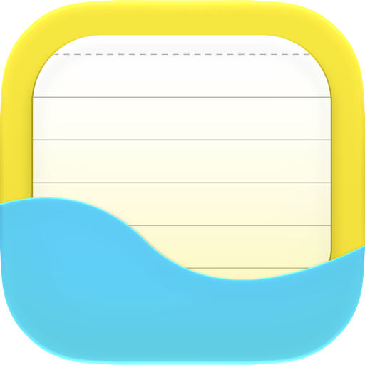
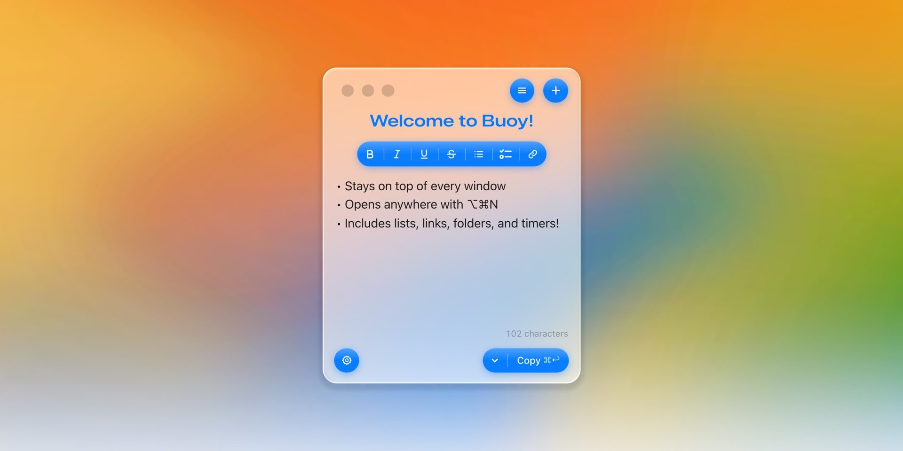

<p align="center">
  <picture>
    <source media="(prefers-color-scheme: dark)" srcset="docs/images/icon-dark.png" />
    
  </picture>
</p>

<h1 align="center">Buoy</h1>

<p align="center"><strong>Notes that float for thoughts that flow.</strong></p>

<p align="center">
  
  
  
  
</p>

<p align="center">
  <a href="https://buoy.gabemempin.me">Website</a> ·
  <a href="https://buoy.gabemempin.me/changelog">Changelog</a> ·
  <a href="https://ko-fi.com/gabemempin">Leave a tip</a>
</p>

<p align="center">
  <picture>
    <source media="(prefers-color-scheme: dark)" srcset="docs/images/hero-dark.jpg" />
    
  </picture>
</p>

Buoy is a lightweight sticky-note app for your Mac. It lives in your menu bar,
stays close without taking over your desktop, and makes it easy to capture notes
from anywhere on your Mac.

## Install

Copy and paste this into Terminal:

```bash
curl -fsSL buoy.gabemempin.me/install.sh | sh
```

Requires macOS 15 Sequoia or later. Free and open source.

Run the same command again to update. Buoy quits, updates itself, and opens
again, and your notes stay right where they are.

<details>
<summary>Why Terminal?</summary>

Publishing on the Mac App Store requires a paid Apple Developer membership, so
the install script is the way around that for now. Buoy installs nothing
system-wide and needs no admin privileges, and since it is open source, you can
read [the script](https://buoy.gabemempin.me/install.sh) and the code before you
run anything.

</details>

## Features

- **Always on top.** Floats above every window, so your note stays in sight
  while you work.
- **Harbor Mode.** Fold Buoy into a small pill when you need the space. Title a
  note with a time, like "5m" or "1 hr 30 min," and the pill counts down.
- **Auto Title.** A new note names itself as you write. Type your own title and
  it stays yours. (Apple Intelligence on macOS 26.)
- **Folders.** Group notes into folders, pin the ones you need, and drag
  anything to reorder.
- **Easy Export.** Copy a note as Markdown, or send it straight to Apple Notes,
  checklists and all.
- **Fog Mode.** Shake the top of the window and everything behind your note fogs
  over, so it is the only thing in focus. Shake again to clear it.
- **Build your Buoy.** Pick a window color and an accent color, and the whole
  panel follows.

### And everything else

- **A global hotkey.** ⌥⌘N opens Buoy from anywhere, and every shortcut can be
  changed.
- **Lists that write themselves.** Type `- ` or `[] ` for a bullet or a to-do;
  Return keeps the list going.
- **Note links.** Type `>>` to link to another note.
- **Embed links seamlessly.** ⌘K opens right by your selection, with a URL you
  just copied filled in.
- **Compact Mode.** Drag Buoy small and its controls shrink to fit.
- **Swipe to switch.** Swipe with two fingers to move between notes, or
  Shift-scroll on a mouse.
- **Shortcuts actions.** Create a note, or add to one, from the Shortcuts app.
- **Light, Dark or Auto.** Follows your Mac, or pick one yourself.

## Private by design

Your notes never leave your Mac. No account, no cloud. Notes are stored in
`~/.buoy/notes.db` and settings in `~/.buoy/settings.json`, and Buoy makes no
network requests with your note content.

## Build from source

Open `Buoy.xcodeproj` in Xcode 26.3 or later and press ⌘R, or run:

```bash
./script/build_and_run.sh
```

Signing is set to "Sign to Run Locally", so no developer account is needed.
Issues and pull requests are welcome.

## License

Buoy is available under the [MIT License](LICENSE).
